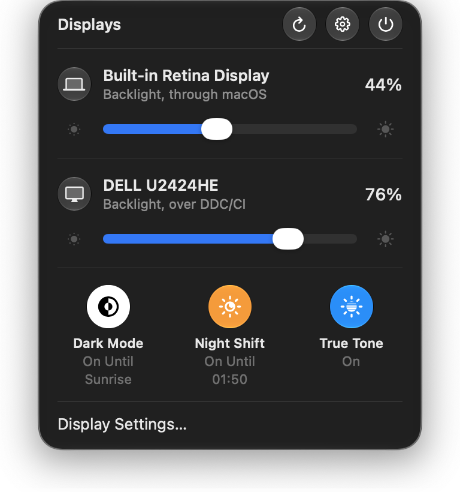

# Dell Monitor Console

One panel for every display on your Mac.

A macOS 26 menu bar panel that sets the backlight of Dell and other DDC/CI monitors and of the built-in display, and
switches Dark Mode, Night Shift and True Tone, so macOS's own Display panel can stay closed. It talks to your monitors
over the cable and to nobody else, has no network code, and is not affiliated with, endorsed by or supported by Dell.

<p align="center"></p>

## by the numbers

Version 2.0.0, measured on 2026-11-02 on a MacBook Pro (M4 Pro, macOS 27.2) with the built-in display and a Dell
U2424HE. Rows marked 1.1.2 were not measured again: they are the 1.1.2 figures from 2026-10-11 and 12, on the same Mac
with a U2723QE as well. Method, raw figures and what was not measured: [docs/METRICS.md](docs/METRICS.md).

| | Dell Monitor Console | Dell's own app (DDPM 2.3) |
|---|---:|---:|
| Installed size | **1,516 KB** | 42,476 KB |
| Files | **4** | 132 |
| Memory, idle | **34 MB** | 51–52 MB |
| CPU, idle | ≈ 0–1 % | 0.4–0.6 % |
| Idle wakeups per minute | **≈ 1** (measured on 1.1.2) | 24–98 |
| Polls your monitors in the background | **never** ¹ | every ~33 s |
| Privacy permissions | **0 in normal use** (Automation is asked only if the Dark Mode fallback runs) | 5 |
| Network | **none** | `dell.com` hosts |
| Launch to its first window | ≈ 0.26 s (measured on 1.1.2) | ≈ 0.3 s |
| All displays read | **0.30–0.32 s** | n/a |
| Features | **4**: brightness, True Tone, Dark Mode, Night Shift | 45 documented commands |

¹ Monitors are read on launch, wake, display change and popover open, never on a timer. With no external monitor
attached, the menu bar icon shows the built-in display's level and re-reads it every 2 s, because the brightness keys
and auto-brightness change it behind the app's back. That read is macOS's own brightness and never touches a monitor.

This covers brightness and three switches on the Mac. It does not switch inputs, drive a KVM, store presets or update
firmware: if you need those, keep Dell's app.

## what you get

| | |
|---|---|
| **One panel** | a macOS 26 Liquid Glass panel from the menu bar: one slider for every display macOS is driving, the built-in one included |
| **Three switches** | Dark Mode, Night Shift and True Tone as round glass toggles under the sliders. Only the ones this Mac has appear (Dark Mode always does). The text under each is worded as macOS words it, such as "On Until Sunrise" |
| **A cross-fade** | Dark Mode switches under a WindowServer fade, as System Settings' own switch does, instead of cutting |
| **Display Settings…** | the last row opens System Settings > Displays and closes the panel. Schedules, arrangement and resolution stay there |
| **Menu bar icon**<br> | the lit rays are the level of the external monitor you used last (else the first); the centre dot means an external monitor is attached. With none attached the rays show the built-in display's level and the dot is off |
| **Scroll the icon** | scrolling over the icon nudges the display it shows and shows the level in place; with no external monitor it changes the built-in panel |
| **Honest state** | a level is shown as set only once the display has reported it, and a toggle shows pending until the system's own read-back confirms it. Otherwise: a symbol on the row, or "Did not change" |
| **No network** | no network API, no socket, no updater. `scripts/check-no-network.sh` fails the build if one appears. The only URLs are three links on the About screen, which open in your browser |
| **Small** | a status item and a panel. No dock icon |

## how each display is controlled

| Shown as | Meaning |
|---|---|
| no glyph | real backlight control: DDC/CI over the display's cable (external), or macOS (built-in) |
| half-filled circle | **software dimming**: the display did not answer DDC/CI, so the picture is dimmed through its gamma table. It lowers the picture, not the backlight, and lasts while the app runs |
| question mark | the write went through but the display did not confirm the level |
| warning triangle | the display did not accept the change |

Which transport a display uses is decided by a real read each time the displays are enumerated (launch, plug, wake,
popover open), so a monitor that starts answering DDC/CI is picked up without a restart.

Some monitors (the Dell U2723QE is one) swallow the first DDC/CI command after sitting idle and answer only the
second, so every request is sent twice, 40 ms apart, before the reply is read. A single request on those displays
only ever gets a null message, which looks exactly like "DDC/CI is off". The app validates every reply (source,
length, checksum, opcode, echoed feature) and reads a level back after each write before it shows it as set.

Dark Mode, Night Shift and True Tone are not DDC: they are set on the Mac. [docs/HOW-IT-WORKS.md](docs/HOW-IT-WORKS.md)
has the detail.

## build

```sh
scripts/bundle.sh                       # builds and signs "build/Dell Monitor Console.app"
open "build/Dell Monitor Console.app"
BIN="build/Dell Monitor Console.app/Contents/MacOS/DellMonitorConsole"
"$BIN" --list                    # each display, how it is controlled, its level
"$BIN" --set U2723QE 60          # set the first display whose name matches, print the result
```

Move the app to `/Applications` before turning on **Open at login**. Requires macOS 26 and Apple silicon.
The app is ad hoc signed, so macOS asks once: right-click, Open.

Four private interfaces are used, all resolved at runtime (`dlsym` or the Objective-C runtime) and none hard-linked:
`IOAVService` in IOKit for DDC/CI on Apple silicon, DisplayServices for the built-in display's brightness,
CoreBrightness for Night Shift and True Tone, and SkyLight for Dark Mode and its fade. If a future macOS removes one,
the matching feature hides or falls back. Without DDC/CI or DisplayServices the app keeps running on software
dimming; a missing Night Shift or True Tone toggle is hidden; Dark Mode falls back to System Events.

---

<sub>Not affiliated with, endorsed by or supported by Dell. The name belongs to its owner.
Source-available under [PolyForm Noncommercial 1.0.0](LICENSE): free for noncommercial use. [Notice](NOTICE.md) · [Metrics](docs/METRICS.md) · [Changelog](CHANGELOG.md)</sub>
